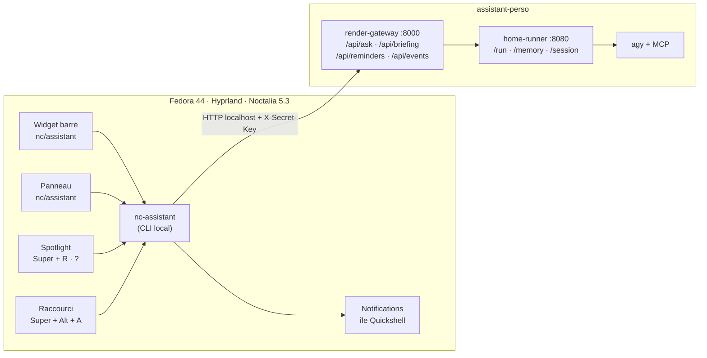
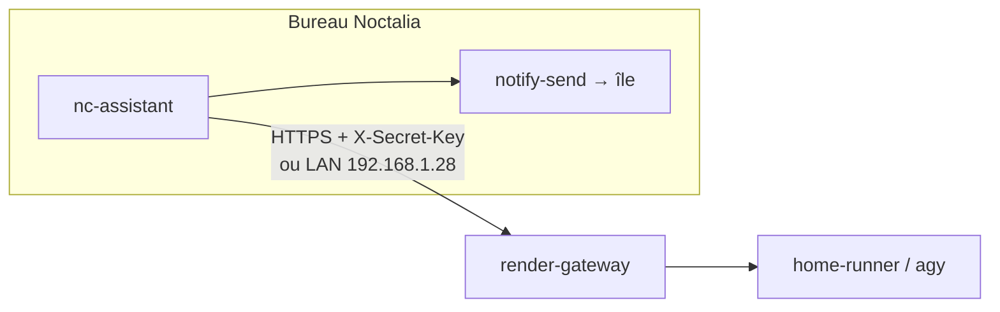

# Intégration `assistant-perso` × rice `noctalia-config`

> **Rapport d'architecture et de mise en œuvre**
> Date : 19 octobre 2026
> Cible : Fedora 44, Hyprland, Noctalia **5.3.0**, rice `noctalia-config` (commit `d6259a2`)
> Projet : `/home/xenospacex/Bureau/assistant-perso` (branche `main`, commit `e498e85`)

---

## 1. Résumé exécutif

Le rice de ton collègue et `assistant-perso` sont **complémentaires**, pas concurrents :

- le rice fournit **le bureau, la barre, l'île dynamique, les notifications, les raccourcis et le suivi des agents IA locaux** (`nc-claude`) ;
- `assistant-perso` fournit **un assistant distant persistant** : mémoire durable, briefing, agenda, tâches, météo, recherche, rappels, STT, exécution via `agy`.

La meilleure intégration n'est **pas** de greffer `assistant-perso` dans les fichiers QML du rice. Ces fichiers sont remplacés à chaque `nc-maj`. La bonne approche est une **couche d'adaptation locale, stable et minimale** :

1. un **CLI passerelle** `~/.local/bin/nc-assistant`, qui parle à l'API HTTP d'`assistant-perso` et ne contient aucun secret en dur ;
2. un **plugin Noctalia local** `nc/assistant` (widget + panneau), qui appelle ce CLI ;
3. des **notifications freedesktop** (`notify-send`), reçues par l'île Quickshell — c'est déjà le mécanisme utilisé par `nc-claude` ;
4. quelques **points d'accroche** : raccourci Hyprland, Spotlight (`?`), briefing et rappels.

Trois niveaux sont proposés :

| Niveau | Contenu | Effort | Risque |
|---|---|---|---|
| **P0** | Corriger la compatibilité du rice avec Noctalia 5.3, vérifier les services, raccourci basique | 30 min | Très faible |
| **P1** | CLI `nc-assistant` + plugin `nc/assistant` + notifications + briefing/rappels sur le bureau | 1 à 2 jours | Faible |
| **P2** | Page dédiée dans l'île Quickshell, suivi d'activité type `nc-claude`, voix, captures d'écran, jobs longs | 3 à 5 jours | Moyen (QML du rice) |

**Recommandation** : faire P0 puis P1. P2 seulement si tu veux l'expérience « assistant natif dans l'île », et dans ce cas contribuer les changements au dépôt du rice pour ne pas les perdre aux mises à jour.

---

## 2. État des lieux

### 2.1 `assistant-perso` : ce qui existe réellement

Deux services Python/FastAPI :

```
Discord / Telegram
        │
        ▼
render-gateway :8000   (bots, briefing, rappels SQLite, route /api/reminders)
        │  HTTP + X-Secret-Key
        ▼
home-runner :8080      (session, mémoire, upload images, /run)
        │  subprocess stream-json
        ▼
agy (Antigravity CLI) ──► Gemini / Claude / GPT-OSS + MCP Google/Weather/Web
```

Points importants pour l'intégration :

| Élément | Réalité actuelle | Conséquence pour le bureau |
|---|---|---|
| API du gateway | `/ping`, `/health`, `/api/reminders` (POST/GET/DELETE) | Il **manque** un endpoint public pour poser une question (`/api/ask`) et pour générer le briefing (`/api/briefing`). |
| API du runner | `/run`, `/session`, `/models`, `/memory`, `/conversations` | Utilisable directement, mais on perd la logique du gateway (plateforme, rappels, briefing). |
| Sessions | `SESSION_CONFIG` **global** dans `agy_bridge.py` | Le bureau partagerait la même conversation que Telegram/Discord. À traiter en P1/P2 (Lot 3.1 de `NEXT_TASKS.md`). |
| Mémoire | `home-runner/memory.json`, versionnée, injectée conditionnellement | Réutilisable telle quelle depuis le bureau. |
| Rappels | SQLite `render-gateway/reminders.db`, plateformes limitées à `telegram` et `discord` | Il faut ajouter une plateforme `desktop` (ou `noctalia`). |
| Briefing | Scheduler interne au gateway, cache `briefing_cache.json` | Le bureau peut le demander, mais aucun endpoint ne l'expose encore. |
| Notifications | Envoyées uniquement vers Telegram/Discord | Il faut un canal « bureau » pour l'île. |
| Sécurité | `X-Secret-Key`, whitelists bots, sandbox `agy` | Le client bureau doit réutiliser la clé, sans la mettre dans le QML. |
| Déploiement | Production annoncée sur `pi@192.168.1.28` | Sur ce poste, les services ne tournent pas actuellement (`8000`/`8080` fermés). |

Le `README.md` actuel décrit bien les bots, mais sous-documente la mémoire durable, les rappels récurrents, le STT, le cache de briefing, le suivi des tokens et les tests. Il est mis à jour dans le même lot que ce rapport.

### 2.2 Le rice `noctalia-config` : ce qui tourne sur cette machine

- **Noctalia 5.3.0** (`noctalia-5.3.0-1.fc44`), dernière version upstream au 19/10/2026.
- **Rice** : `/home/xenospacex/noctalia-config`, commit `d6259a2` du 18/10/2026.
- **Hyprland en Lua** (`~/.config/hypr/nc/*.lua`), config Noctalia dans `~/.config/noctalia/config.toml`.
- **Île dynamique Quickshell** : service `nc-ile.service` **actif**. Sur Fedora, `install.sh` choisit Quickshell et désactive l'île en plugin Noctalia (`ILE=quickshell`, `center=[]`, `nc/ile` non activé).
- **Notifications** : c'est l'île Quickshell qui implémente `org.freedesktop.Notifications` (`Notifs.qml`). Le démon de notifications de Noctalia est désactivé (`NOTIF_NOCTALIA=false`). **Conséquence : `notify-send` est le bon canal, pas `noctalia msg notification-show`.**
- **Agents IA** : `nc-claude` suit Claude Code, Antigravity, OpenCode, Gemini, Codex, etc. et écrit `$XDG_RUNTIME_DIR/nc-claude/etat.json`, lu par `Agents.qml`. C'est le modèle à imiter pour un futur suivi d'`assistant-perso`.
- **Spotlight** : `Super + R`, géré par `Recherche.qml`, qui appelle `nc-demander` pour le préfixe `?`.
- **Plugins locaux** : `~/.local/share/noctalia/plugins/nc-{carousel,fenetres,ile,keys,launcher,verrou}`.
- **Fichiers personnels préservés** : `~/.config/nc/reglages.conf`, `raccourcis.conf`, `~/.config/hypr/perso.lua`, `~/.zshrc.perso`, `~/.config/kitty/perso.conf`. Les fichiers du rice (QML, Lua Hyprland, plugins) sont, eux, recopiés par `nc-maj`.

### 2.3 Compatibilité constatée : un correctif à faire tout de suite

Le plugin `nc/fenetres` est **ignoré** au démarrage :

```text
[WRN] [plugins] ignoring plugin at .../nc-fenetres:
      widget entry 'titre': hover_highlight requires plugin_api >= 34
[WRN] [shell] widget factory: unknown widget "nc/fenetres:titre"
```

Cause : `plugin.toml` déclare `plugin_api = 32`, mais `hover_highlight` est une fonctionnalité de Noctalia 5.3 qui exige l'API 34. Noctalia 5.3.0 **sait** charger l'API 34 : le `lint` passe après correction.

Correctif validé :

```bash
# Dans le dépôt du rice ET dans le plugin installé
sed -i 's/^plugin_api  = 32/plugin_api  = 34/' \
  ~/noctalia-config/home/.local/share/noctalia/plugins/nc-fenetres/plugin.toml \
  ~/.local/share/noctalia/plugins/nc-fenetres/plugin.toml

noctalia plugins lint ~/.local/share/noctalia/plugins/nc-fenetres
# → nc/fenetres  ok  0 errors, 0 warnings

systemctl --user restart noctalia.service
```

Sans ce correctif, le côté droit de la barre (titre de fenêtre, survol des fenêtres) reste absent. Ce n'est pas bloquant pour `assistant-perso`, mais il faut le corriger avant de toucher à la barre.

Autres observations :

- `~/.config/noctalia/config.toml` contient encore `[widget."nc/ile:pilule"]` alors que le plugin `nc/ile` n'est pas activé (île Quickshell). Noctalia logue `unrecognized widget type "nc/ile:pilule"`. C'est **cosmétique** : on peut supprimer ce bloc ou l'ignorer.
- Le README du rice annonce « Noctalia v5 » et une config vérifiée en `5.2.1` ; la machine est en `5.3.0`. Aucun blocage, mais il faut **épingler la version** et lancer `nc-maj` avec attention.
- `nc/ile` est listé `disabled` par `noctalia msg plugins list` : c'est normal sur Fedora, l'île est fournie par Quickshell.

---

## 3. Principes d'intégration

1. **Ne pas forker le rice.** Toute personnalisation va dans les fichiers « à toi » : `~/.config/nc/`, `~/.config/hypr/perso.lua`, `~/.local/bin/`, `~/.local/share/noctalia/plugins/nc-assistant/`.
2. **Une seule couche de couplage** : le CLI `nc-assistant`. Le QML/Luau ne connaît ni `agy`, ni les tokens, ni les chemins du projet. Il appelle des commandes stables.
3. **Notifications par `notify-send`.** L'île Quickshell écoute le bus freedesktop. `noctalia msg notification-show` passe par le démon interne de Noctalia, désactivé ici.
4. **Secrets hors du bureau.** Le CLI lit `~/.config/nc/assistant.conf` (chmod `600`) ou un fichier `.env` ; le plugin ne reçoit jamais la clé.
5. **Local d'abord.** Gateway/runner sur `127.0.0.1` ou le LAN. Si le gateway est distant (Render/Pi), HTTPS + `X-Secret-Key`, jamais de HTTP en clair hors LAN.
6. **Dégradation propre.** Si le gateway est arrêté, le widget affiche « hors ligne » et les commandes expliquent quoi faire ; rien ne bloque le bureau.
7. **Idempotence et reprise.** Les rappels et le briefing doivent survivre à un redémarrage de session ; on réutilise SQLite et les fichiers d'état existants.

---

## 4. Architecture cible recommandée

### 4.1 Mode local (recommandé)



### 4.2 Mode distant (Pi ou Render)



Dans les deux cas, **le bureau ne parle jamais directement à `agy`**. Il passe par le gateway, ce qui garantit la mémoire, les sessions, les rappels et la journalisation.

### 4.3 Exposition du gateway hors du réseau local

Une URL `http://192.168.1.28:8000` n'est joignable que sur le LAN. Pour un
usage depuis un autre réseau, le dépôt fournit :

```bash
./scripts/expose-gateway.sh quick       # Cloudflare Tunnel temporaire
./scripts/expose-gateway.sh cloudflare --hostname assistant.tondomaine.fr
./scripts/expose-gateway.sh tailscale   # réseau privé Tailscale
```

Le script expose le **gateway `8000`**, pas le runner `8080`. Le client Noctalia
reçoit ensuite l'URL HTTPS dans `nc-assistant configurer`, puis la vérifie avec
`nc-assistant verifier`. Guide complet : [`docs/ACCES_DISTANT.md`](docs/ACCES_DISTANT.md).

Côté gateway, `DESKTOP_RATE_LIMIT_PER_MINUTE` limite `/api/*` et
`TRUST_PROXY_HEADERS=1` permet de compter la vraie IP derrière Cloudflare.

---

## 5. Intégration P0 — compatibilité et hygiène (30 min)

1. **Corriger `nc/fenetres`** (`plugin_api = 34`), relancer `noctalia.service`, vérifier `noctalia plugins lint`.
2. **Vérifier la santé du rice** :

   ```bash
   noctalia --version
   noctalia msg status
   systemctl --user --no-pager status noctalia nc-ile
   noctalia plugins lint ~/.local/share/noctalia/plugins/*
   ```

3. **Décider où tourne `assistant-perso`** :
   - sur le poste : `deploy.sh`, puis units systemd utilisateur ;
   - sur le Pi : `HOME_SERVER_URL=http://192.168.1.28:8080` sur le poste, ou URL HTTPS si distant.
4. **Vérifier le secret** : `chmod 600` sur les `.env`, `token.json`, `memory.json`. Ne jamais mettre `SECRET_KEY` dans un fichier lu par le QML.
5. **Ajouter un raccourci de test** (sans plugin, pour valider la chaîne) :

   ```bash
   nc-raccourci ajoute "Super+Alt+A" \
     "notify-send -a 'Assistant personnel' 'Assistant' 'Le pont nc-assistant est prêt'" \
     "Assistant|Test de notification"
   ```

   Puis `Super + /` doit afficher le raccourci. Cela valide `nc-raccourci` + l'île de notifications.

---

## 6. Intégration P1 — l'assistant dans la barre (recommandé)

### 6.1 Contrat du CLI `nc-assistant`

Créer `~/.local/bin/nc-assistant` (Python 3, exécutable, sans dépendance externe). Commandes proposées :

| Commande | Sortie / effet | Utilisé par |
|---|---|---|
| `nc-assistant etat --json` | JSON : `online`, `version`, `session`, `modele`, `effort`, `rappels`, `prochain_briefing`, `derniere_erreur` | widget barre |
| `nc-assistant demander TEXTE [--image FICHIER]` | réponse complète (ou flux avec `--flux`) | panneau, Spotlight |
| `nc-assistant briefing` | texte du briefing (cache si valide) | panneau, notification |
| `nc-assistant rappels` | liste lisible / JSON | panneau |
| `nc-assistant rappel ...` | crée un rappel `platform=desktop` | panneau |
| `nc-assistant snooze ID [DUREE]` | reporte un rappel | notification |
| `nc-assistant termine ID` | clôt un rappel | notification |
| `nc-assistant nouvelle` | réinitialise la session bureau | panneau |
| `nc-assistant panneau` | ouvre le panneau Noctalia (via `noctalia msg panel-toggle nc/assistant:main`) | raccourci, clic notification |
| `nc-assistant watch` | écoute les événements et appelle `notify-send` | service utilisateur |

Le CLI lit la configuration dans `~/.config/nc/assistant.conf` :

```ini
# ~/.config/nc/assistant.conf — chmod 600
# LAN : http://127.0.0.1:8000 ou http://192.168.1.28:8000
# Autre réseau : URL HTTPS du tunnel (Cloudflare/Tailscale/Render)
URL=https://assistant.tondomaine.fr
SECRET_KEY=...
PLATFORM=desktop
USER_ID=noctalia
TIMEOUT=180
```

Il ne doit **jamais** afficher la clé, même en cas d'erreur.

Exemple de contrat JSON pour le widget :

```json
{
  "online": true,
  "version": "1.0.0",
  "session": {"active": true, "turns": 4, "model": "gemini-3.8-flash-low"},
  "usage": {"requests": 12, "input_tokens": 8400, "output_tokens": 2100},
  "reminders": {"count": 2, "next": "2026-10-19T18:30:00+02:00"},
  "briefing": {"time": "08:00", "cached": true},
  "error": null
}
```

### 6.2 Plugin Noctalia `nc/assistant`

Arborescence stable, hors des fichiers remplacés par le rice :

```text
~/.local/share/noctalia/plugins/nc-assistant/
├── plugin.toml
├── widget.luau      # pastille dans la barre
└── panneau.luau     # panneau principal
```

`plugin.toml` minimal :

```toml
id          = "nc/assistant"
name        = "Assistant personnel"
version     = "1.0.0"
plugin_api  = 34
author      = "toi"
license     = "MIT"
description = "Assistant personnel : briefing, questions, rappels, état de la session."
dependencies = ["python3", "notify-send"]

[[widget]]
id = "pastille"
entry = "widget.luau"

  [widget.actions]
  left = "exec noctalia msg panel-toggle nc/assistant:main"

[[panel]]
id = "main"
entry = "panneau.luau"
width = 520
height = 640
placement = "floating"
position = "center"
```

Le widget :

- icône `auto_awesome` (ou une icône du thème NC) ;
- badge discret si un rappel est dû ou si le gateway est hors ligne ;
- clic : ouvre `nc/assistant:main` ;
- clic droit : `nc-assistant briefing` puis notification ;
- pas de boucle réseau agressive : `noctalia.runAsync({ "nc-assistant", "etat", "--json" }, ...)` toutes les 30–60 s, et `noctalia.setUpdateInterval` seulement pendant une requête.

Le panneau propose quatre zones :

1. **Statut** : en ligne/hors ligne, modèle, effort, session, tokens ;
2. **Question rapide** : champ texte + bouton « Demander », réponse en streaming (`noctalia.runStream` sur `nc-assistant demander --flux`) ;
3. **Briefing** : bouton « Générer », texte défilant, bouton « Copier » (`noctalia.copyToClipboard`) ;
4. **Rappels** : liste, boutons « Reporter 10 min », « Terminé », « Annuler ».

Le plugin reste **autonome** : si `nc-assistant` n'existe pas, il affiche une erreur claire et ne casse pas la barre.

### 6.3 Notifications : rappels, briefing et fin de tâche

L'île utilise le protocole freedesktop. Un wrapper « notification avec action » peut s'inspirer de `nc-claude notification` :

```bash
#!/usr/bin/env bash
# nc-assistant-notify : notification avec clic « Ouvrir »
titre="${1:-Assistant personnel}"
texte="${2:-}"
action="$(notify-send -a "Assistant personnel" -i dialog-information \
  -A "default=Ouvrir" -A "snooze=Reporter 10 min" "$titre" "$texte")"
case "$action" in
  default) exec "$HOME/.local/bin/nc-assistant" panneau ;;
  snooze)  exec "$HOME/.local/bin/nc-assistant" snooze "${3:-10m}" ;;
esac
```

Recommandations :

- **briefing** : notification à l'heure configurée, avec `-u normal`, texte tronqué à ~4 lignes ; le panneau affiche le texte complet ;
- **rappel** : `-u critical` pour les rappels importants, `-u normal` sinon ;
- **confidentialité** : option `ASSISTANT_NOTIF_DETAIL=non` pour n'afficher que « Nouveau briefing » / « Rappel » quand l'écran est verrouillé ou en « Ne pas déranger » ;
- **anti-doublon** : le gateway reste la source de vérité (SQLite) ; le CLI ne notifie que les événements non encore acquittés.

### 6.4 Évolutions nécessaires côté `assistant-perso`

| Ajout | Détail | Priorité |
|---|---|---|
| `POST /api/ask` | Corps `{prompt, platform:"desktop", user_id, timeout, continue_session}`. Réutilise `forward_to_runner()` et la logique de commandes. Protégé par `X-Secret-Key`. | P1 |
| `POST /api/briefing` | Retourne `{success, output, cached, generated_at}`. Réutilise `get_briefing_text()`. | P1 |
| `GET /api/events` (SSE) ou `GET /api/outbox?since=ID` | File d'événements `reminder_due`, `briefing_ready`, `job_done`. Le CLI `watch` la consomme et notifie. | P1 |
| Plateforme `desktop` dans `/api/reminders` | Accepter `platform=desktop` en plus de `telegram`/`discord`, avec `chat_id=noctalia`. | P1 |
| `GET /api/status` | Agrège `/health` runner + gateway + session + compteurs. Le widget n'a qu'un appel à faire. | P1 |
| Sessions par `(platform, user_id)` | Évite que le bureau écrase la conversation Telegram. Reprend le Lot 3.1 de `NEXT_TASKS.md`. | P2 |
| File de jobs | `POST /jobs`, `GET /jobs/{id}`, notification à la fin. | P2 |

Exemple d'appel :

```bash
curl -sS http://127.0.0.1:8000/api/ask \
  -H "Content-Type: application/json" \
  -H "X-Secret-Key: $SECRET_KEY" \
  -d '{"prompt":"Résume mon agenda de demain","platform":"desktop","user_id":"noctalia","continue_session":false}'
```

Réponse normalisée :

```json
{"success": true, "output": "Demain : …", "session": {"turns": 1}, "error": null}
```

### 6.5 Spotlight `?` : brancher `nc-demander` sur l'assistant

`Recherche.qml` appelle déjà `nc-demander --flux QUESTION`. Le plus simple est d'étendre `nc-demander` :

- ajouter `assistant` à `NOMS` et à `SPOTLIGHT_IA` (`auto`, `claude`, `opencode`, `gemini`, `qwen`, **`assistant`**, `non`) ;
- si `assistant` est choisi, appeler `nc-assistant demander --flux` au lieu de lancer un CLI IA local ;
- conserver le format `{"t": "..."}` pour que le Spotlight continue d'afficher la réponse au fil de l'eau.

Cela donne `? quel temps demain à Toulouse` → réponse de ton assistant, avec sa mémoire et ses MCP, sans toucher au QML.

### 6.6 Raccourcis et intégration Hyprland

```bash
# Panneau assistant
nc-raccourci ajoute "Super+Alt+A" "~/.local/bin/nc-assistant panneau" "Assistant|Ouvrir l'assistant"

# Briefing immédiat
nc-raccourci ajoute "Super+Alt+B" "~/.local/bin/nc-assistant briefing" "Assistant|Briefing du jour"

# Question sur la sélection (si tu ajoutes le support plus tard)
nc-raccourci ajoute "Super+Alt+Q" "~/.local/bin/nc-assistant selection" "Assistant|Demander sur la sélection"
```

Les raccourcis sont dans `~/.config/nc/raccourcis.conf`, jamais remplacés par `nc-maj`, et apparaissent dans `Super + /`.

Option dock/launcher : ajouter un `.desktop` `assistant-personnel.desktop` qui lance `nc-assistant panneau`, puis l'épingler. Cela évite de toucher `config.toml`.

---

## 7. Intégration P2 — expérience « native île » (optionnelle)

À ne faire qu'après P1, et de préférence **en contribuant au dépôt du rice**.

### 7.1 Page dans l'île Quickshell

Le rice a déjà `Agents.qml`, `Claude.qml`, `DemandeClaude.qml`, `Etat.qml`. On peut :

- ajouter un type d'agent `assistant` dans `Agents.ias` (nom, couleur, réglage `ASSISTANT_ILE`) ;
- écrire `~/.local/share/nc-assistant/etat.json` au même format que `nc-claude` (`sessions`, `demandes`, `etat`, `etape`, `maj`) ;
- ajouter une page « Assistant » dans `Ile.qml` / `Centre.qml`, ou réutiliser la page agents ;
- ajouter un état « travail / fini / t’attend » dans `Compact.qml`.

Avantage : expérience très intégrée. Inconvénient : ces fichiers sont **remplacés par `nc-maj`**. Il faut donc :

1. proposer le patch au dépôt `abcdef123456-wq/noctalia-config` ;
2. ou maintenir un fork et changer l'origine de `nc-maj` ;
3. ou accepter de réappliquer le patch après chaque mise à jour (fragile).

### 7.2 Voix et captures

- **STT** : `assistant-perso` sait déjà transcrire les vocaux Telegram/Discord. Pour le bureau, enregistrer un fichier audio (`wf-recorder`, `parec`) puis appeler un nouvel endpoint `/api/stt` ou envoyer le fichier à `/api/ask`. Le rice fournit `nc-capture` pour les captures d'écran : un raccourci « capture → question » est naturel.
- **TTS** : optionnel, via `piper` ou `espeak-ng`, à déclencher depuis le panneau.
- **Contexte fenêtre** : `hyprctl activewindow -j` + sélection de texte (presse-papiers) pour « Explique ce que je regarde ».

### 7.3 Jobs longs

Pour les missions longues (recherche, analyse de documents), ajouter une file côté runner et un badge dans le widget. `nc-claude` fournit déjà le modèle d’états `travail` / `fini` / `demande`, réutilisable.

---

## 8. Sécurité

| Risque | Mesure |
|---|---|
| Clé exposée dans le QML ou la ligne de commande | CLI uniquement, fichier `600`, jamais d’argument `--secret`. |
| Gateway accessible depuis le réseau | Bind `127.0.0.1` par défaut ; si LAN, firewall + `X-Secret-Key` ; si Internet, HTTPS/Tunnel. |
| Abus / brute force sur l'API publique | `DESKTOP_RATE_LIMIT_PER_MINUTE` (60/min par IP), `TRUST_PROXY_HEADERS=1` derrière Cloudflare. |
| Runner exposé par erreur | N'exposer que le gateway `8000` ; le runner `8080` reste privé. |
| Fuite de contenu dans les notifications | Option de mode discret ; ne pas afficher le texte complet sur l’écran verrouillé. |
| Injection de prompt via e-mails/web | Déjà couverte par `GEMINI.md` ; le bureau doit envoyer le même préambule de sécurité. |
| Actions destructrices depuis le panneau | Le panneau ne doit exposer que des actions réversibles ; les actions `agy` restent en `request-review` si tu veux confirmer. |
| Secret dans les logs | Le gateway masque déjà `httpx` ; le CLI doit masquer l’URL et la clé dans ses erreurs. |
| Accès multi-utilisateur | Whitelists bots inchangées ; le client bureau utilise un identifiant dédié `noctalia`. |

Recommandation systemd pour le service `nc-assistant watch` :

```ini
[Unit]
Description=Assistant personnel — notifications bureau
After=graphical-session.target
PartOf=graphical-session.target

[Service]
ExecStart=%h/.local/bin/nc-assistant watch
Restart=on-failure
RestartSec=5
NoNewPrivileges=true
PrivateTmp=true

[Install]
WantedBy=graphical-session.target
```

---

## 9. Compatibilité et maintenance avec le rice

- **Épingler** le commit du rice (`d6259a2`) et vérifier `noctalia --version` avant/après `nc-maj`.
- **Ne jamais éditer** `~/.config/quickshell/nc-ile/*`, `~/.config/noctalia/config.toml` ni les plugins du rice pour y mettre de la logique métier : ces fichiers sont recopiés.
- **Centraliser** les personnalisations dans :
  - `~/.config/nc/assistant.conf` ;
  - `~/.local/bin/nc-assistant*` ;
  - `~/.local/share/noctalia/plugins/nc-assistant/` ;
  - `~/.config/hypr/perso.lua` et `~/.config/nc/raccourcis.conf`.
- **Corriger `plugin_api`** dans le dépôt du rice (pas seulement localement) pour que ton collègue et les autres utilisateurs en profitent.
- **Proposer au rice** : un plugin `nc/assistant` générique + un mode `assistant` dans `nc-demander`. C’est la voie la plus durable.
- **Matrice de versions** :

| Composant | Version constatée | Compatibilité |
|---|---|---|
| Fedora | 44 | OK |
| Noctalia | 5.3.0 | OK, API 34 supportée |
| Rice `noctalia-config` | `d6259a2` (18/10/2026) | Un plugin à corriger (`nc/fenetres`) |
| Hyprland | Lua, 0.55+ | OK |
| Quickshell | 0.3.x (COPR) | OK, île active |
| `assistant-perso` | `e498e85` | Python 3.14, services non lancés sur ce poste |

---

## 10. Feuille de route et critères d’acceptation

| Étape | Effort | Critère d’acceptation |
|---|---|---|
| **P0.1** Corriger `nc/fenetres` | 5 min | `noctalia plugins lint` OK ; titre de fenêtre visible après redémarrage. |
| **P0.2** Vérifier la chaîne de notification | 10 min | `notify-send` affiche une bannière dans l’île ; clic ouvre l’historique. |
| **P0.3** Décider local/distant | 15 min | `nc-assistant etat` répond `online: true` (ou message clair). |
| **P1.1** CLI `nc-assistant` | 0,5 j | `etat`, `demander`, `briefing`, `rappels` fonctionnent ; aucune clé affichée. |
| **P1.2** Endpoints gateway | 0,5 j | `/api/ask`, `/api/briefing`, `/api/status` protégés ; tests unitaires. |
| **P1.3** Plugin widget + panneau | 0,5 j | Widget dans la barre, panneau opérationnel, mode hors ligne propre. |
| **P1.4** Notifications + rappels `desktop` | 0,5 j | Un rappel créé depuis le panneau arrive dans l’île ; snooze et termine fonctionnent. |
| **P1.5** Spotlight + raccourci | 0,25 j | `?` répond via l’assistant ; `Super + Alt + A` ouvre le panneau. |
| **P2.1** Page île Quickshell | 2 j | Page « Assistant » avec états travail/fini, patch proposé au rice. |
| **P2.2** Voix / capture / jobs | 2 j | Question vocale ou capture → réponse dans le panneau. |

---

## 11. Risques et pièges

1. **Sessions partagées** : le runner a une session globale. Sans travail sur les sessions, une question depuis le bureau peut modifier la conversation Telegram. À traiter avant de généraliser.
2. **Gateway distant** : chaque question traverse le réseau ; le mode streaming devient important pour la perception de rapidité.
3. **Notifications en double** : si tu actives à la fois le canal Telegram et le canal bureau, un rappel peut arriver deux fois. Utiliser une plateforme par rappel, ou un champ `notify` explicite.
4. **Mises à jour du rice** : `nc-maj` remplace les QML et les plugins du rice. Le plugin `nc-assistant` et ses fichiers personnels survivent ; un patch dans `Agents.qml` ne survit pas.
5. **API plugin Noctalia** : elle évolue vite (API 32 → 34 entre 5.2 et 5.3). Épingler et tester `noctalia plugins lint` après chaque mise à jour.
6. **Coût des tokens** : le widget ne doit pas interroger le modèle pour afficher l’état ; seuls `/health` et des compteurs locaux. Le briefing doit utiliser le cache.
7. **Confidentialité** : le briefing contient e-mails et agenda ; ne pas l’afficher en clair sur l’écran verrouillé.

---

## 12. Annexes

### A. Vérifications rapides

```bash
# Noctalia / rice
noctalia --version
noctalia msg status
noctalia plugins lint ~/.local/share/noctalia/plugins/*
systemctl --user --no-pager status noctalia nc-ile

# assistant-perso (si local)
curl -sS http://127.0.0.1:8080/ping
curl -sS http://127.0.0.1:8000/health

# Notification de test
notify-send -a "Assistant personnel" -i dialog-information \
  "Test" "Si cette bannière apparaît dans l'île, le canal est bon."
```

### B. Squelette de `nc-assistant` (pseudo-code)

```python
#!/usr/bin/env python3
"""nc-assistant : pont entre le bureau Noctalia et assistant-perso."""
import json, os, subprocess, sys, urllib.request

CONF = os.path.expanduser("~/.config/nc/assistant.conf")

def conf():
    d = {}
    with open(CONF, encoding="utf-8") as f:
        for line in f:
            if "=" in line and not line.lstrip().startswith("#"):
                k, v = line.strip().split("=", 1)
                d[k] = v
    return d

def api(path, payload=None, timeout=180):
    c = conf()
    req = urllib.request.Request(
        c["URL"].rstrip("/") + path,
        data=json.dumps(payload).encode() if payload else None,
        headers={"Content-Type": "application/json", "X-Secret-Key": c["SECRET_KEY"]},
        method="POST" if payload else "GET",
    )
    with urllib.request.urlopen(req, timeout=timeout) as r:
        return json.load(r)

def main(argv):
    cmd = argv[1] if len(argv) > 1 else "etat"
    if cmd == "etat":
        out = {"online": False}
        try:
            h = api("/api/status", timeout=5)
            out.update(online=True, **h)
        except Exception as e:
            out["error"] = type(e).__name__
        print(json.dumps(out, ensure_ascii=False)); return 0
    if cmd == "demander":
        r = api("/api/ask", {"prompt": " ".join(argv[2:]),
                             "platform": conf().get("PLATFORM", "desktop"),
                             "user_id": conf().get("USER_ID", "noctalia"),
                             "continue_session": True})
        print(r.get("output") or r.get("error") or ""); return 0 if r.get("success") else 1
    if cmd == "briefing":
        r = api("/api/briefing", {"force_refresh": False}, timeout=240)
        print(r.get("output") or r.get("error") or ""); return 0 if r.get("success") else 1
    if cmd == "panneau":
        return subprocess.call(["noctalia", "msg", "panel-toggle", "nc/assistant:main"])
    print(f"Commande inconnue : {cmd}", file=sys.stderr); return 2

if __name__ == "__main__":
    sys.exit(main(sys.argv))
```

### C. Extrait de log à corriger

```text
[WRN] [plugins] ignoring plugin at /home/xenospacex/.local/share/noctalia/plugins/nc-fenetres:
      widget entry 'titre': hover_highlight requires plugin_api >= 34
[WRN] [shell] widget factory: unknown widget "nc/fenetres:titre"
```

### D. Références locales

- `~/.config/noctalia/config.toml` — barre, dock, thème, plugins.
- `~/.local/share/noctalia/plugins/nc-ile/` — île au format plugin (non utilisée ici).
- `~/.config/quickshell/nc-ile/` — île Quickshell réellement utilisée.
- `~/.local/bin/nc-claude` — modèle de suivi d’agents et de notifications.
- `~/.local/bin/nc-demander` — modèle d’appel IA pour le Spotlight.
- `~/.local/bin/nc-shell-msg` — actions de la barre / ouverture des panneaux.
- `~/.local/bin/nc-raccourci` — ajout de raccourcis persistants.
- `~/noctalia-config/install.sh` — logique Fedora (`ILE=quickshell`, notifications, plugins).

---

## 13. Conclusion

Le chemin le plus robuste est **P0 + P1** :

- **P0** remet le rice en conformité avec Noctalia 5.3 (un plugin à corriger) ;
- **P1** ajoute une **passerelle CLI stable**, un **plugin local `nc/assistant`**, des **notifications via l’île** et raccorde **briefing, rappels et Spotlight** sans modifier les fichiers du rice.

Cette approche donne 90 % de la valeur (assistant accessible en un raccourci, réponses dans l’île, rappels et briefing sur le bureau) avec un risque de maintenance faible. P2 est un projet séparé, à faire en contribuant au rice si tu veux une intégration visuelle vraiment native.
