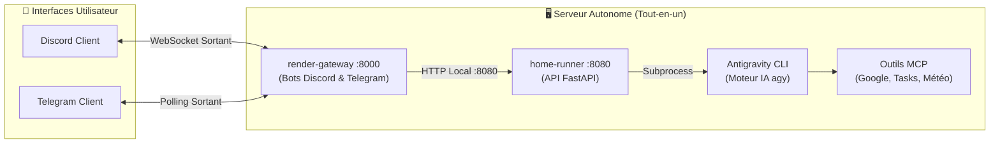
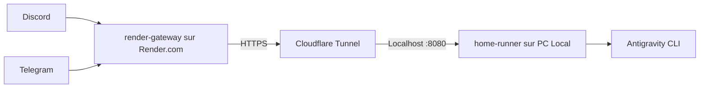
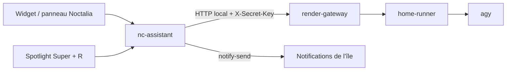

# 🤖 Assistant Personnel — AI Agent & Gateway

<p align="center">
  
  
  
  
  
  
</p>

> **Un assistant personnel IA autonome, ultra-rapide et connecté à votre quotidien.**  
> Pilotez votre machine, vos e-mails, votre agenda, vos tâches et le web directement depuis **Discord** et **Telegram**, propulsé par **Antigravity CLI** et les modèles de raisonnement Google Gemini.
>
> Le projet s'intègre aussi à un **bureau Linux Hyprland / Noctalia** : widget et panneau dans la barre, notifications dans l'île dynamique, briefing et rappels sur le poste. Voir le [rapport d'intégration Noctalia](INTEGRATION_NOCTALIA.md).

---

## 🌟 Fonctionnalités Principales

- **🌅 Briefing Matinal Automatisé** :
  - Déclenché automatiquement chaque matin à **08h00** ou sur commande (`/briefing`).
  - Analyse synthétique : **Emploi du temps du jour**, **E-mails importants filtrés** (anti-spam), **Tâches Google Tasks**, **Météo locale** et **Actualités économiques clés**.
- **⚡ Réponses Ultra-Rapides & Mode Éco** :
  - Optimisé pour le chat mobile avec `gemini-3.8-flash-low` et effort de raisonnement direct pour des réponses complètes en moins de **15 à 20 secondes**.
- **💬 Intégration Bi-Plateforme Complète** :
  - **Discord** : Commandes slash natives (`/ask`, `/briefing`, `/model`, `/session`, `/clear`), accusé de réception instantané (évite les erreurs timeout 3s), réponses élégantes découpées en blocs formatés.
  - **Telegram** : Menus interactifs, boutons inline, mode webhook ou polling automatique sans configuration réseau.
- **🧠 Gestion de Contexte & Mémoire** :
  - Mémoire de conversation persistante avec suivi des tours de discussion.
  - **Mémoire durable** (`/souviens`, `/profil`) stockée localement, injectée dans les prompts seulement quand elle change, avec compaction automatique au-delà de `AUTO_COMPACT_TURNS`.
  - Commutation de session ou de modèle à la volée sans redémarrer le serveur.
  - Possibilité de reprendre d'anciennes conversations passées ou de purger le chat.
- **⏰ Rappels persistants & récurrents** :
  - Rappels ponctuels ou récurrents (`chaque jour`, `en semaine`, `chaque lundi`, `chaque mois`) stockés en SQLite.
  - Détection en langage naturel, y compris depuis les messages vocaux.
  - Snooze, clôture et reprogrammation automatique de l'occurrence suivante.
- **🎙️ Messages vocaux (STT)** :
  - Transcription automatique des vocaux Telegram et Discord (Groq Whisper, OpenAI Whisper ou `faster-whisper` en local).
  - Les rappels et questions dictés sont traités comme du texte.
- **📊 Suivi des tokens & cache du briefing** :
  - Compteurs locaux de requêtes, tokens d'entrée/sortie et de caractères, exposés par `/usage`.
  - Briefing mis en cache (`BRIEFING_CACHE_TTL_MINUTES`) pour éviter les appels redondants au modèle.
- **🖥️ Intégration bureau (Noctalia / Hyprland)** :
  - Cible : passerelle locale `nc-assistant`, widget et panneau Noctalia, notifications dans l'île Quickshell.
  - Voir [INTEGRATION_NOCTALIA.md](INTEGRATION_NOCTALIA.md) pour l'architecture recommandée, le contrat du CLI et la compatibilité Noctalia 5.3.
- **📐 Support LaTeX & Formules Mathématiques** :
  - Rendu graphique automatique des équations de bloc (`$$...$$`) en images PNG nettes adaptées au mode sombre.
  - Conversion automatique des formules en ligne (`$...$`) en symboles mathématiques Unicode clairs (ex: `α`, `β`, `π`, `x²`, `√`, `∫`, `∈`, `ℝ`).
- **👁️ Support Multimodal & Analyse d'Images** :
  - Envoyez une photo, capture d'écran, schéma ou exercice directement sur Discord (`/ask [image]` ou upload direct) ou Telegram (envoi de photo avec légende).
  - Analyse visuelle complète assurée par le modèle multimodal Gemini via Antigravity CLI.
- **📋 Code Copiable en 1 Clic & Fichiers Attachés** :
  - Coloration syntaxique complète avec activation du bouton de copie natif Telegram et Discord.
  - Découpage intelligent (`smart_split`) évitant toute troncature au milieu d'un bloc de code.
  - Envoi automatique des extraits de code volumineux sous forme de fichiers téléchargeables (`.py`, `.js`, `.sh`, etc.).
- **🔌 Connecteurs MCP (Model Context Protocol)** :
  - 📅 **Google Agenda** : Lecture et création d'événements.
  - ✉️ **Gmail** : Tri et résumé intelligent des e-mails prioritaires.
  - 📋 **Google Tasks** : Gestion et suivi des listes de tâches.
  - 📁 **Google Drive** : Recherche et consultation de documents.
  - 🌤️ **Météo** & 🌐 **Recherche Web DuckDuckGo**.

---

## 🏗️ Architecture & Déploiement

Le projet supporte **plusieurs modes de déploiement** selon vos besoins :

### Mode 1 : Serveur Autonome Tout-en-un (Recommandé) ⭐
Idéal sur un serveur personnel (mini-PC, Raspberry Pi, serveur Debian/Ubuntu) allumé 24/7.



> [!TIP]
> **Zéro galère réseau** : Dans ce mode, **aucun port n'a besoin d'être ouvert** sur votre box Internet, aucun nom de domaine n'est requis, et le bot reste actif en permanence.

---

### Mode 2 : Architecture Hybride Cloud + PC Local
Si vous préférez héberger la passerelle sur Render et le moteur IA sur votre PC de bureau personnel :



---

### Mode 3 : Client bureau Noctalia / Hyprland (optionnel)

Le projet peut être piloté depuis le bureau, sans passer par Discord ou Telegram.
La cible est une fine passerelle locale (`nc-assistant`) qui appelle le gateway et affiche
le résultat dans la barre Noctalia, le panneau ou une notification de l'île dynamique :



> [!NOTE]
> Le bureau ne lance jamais `agy` directement : il passe par le gateway pour conserver
> la mémoire, les sessions, les rappels et la journalisation. Le détail (contrat du CLI,
> plugin Noctalia, notifications, sécurité) est dans [INTEGRATION_NOCTALIA.md](INTEGRATION_NOCTALIA.md).

#### Utilisation depuis un autre réseau

Une URL `http://192.168.x.x:8000` ne fonctionne que sur le réseau local du
serveur. Pour utiliser l'assistant depuis un autre Wi-Fi ou Internet, expose le
**gateway** (port `8000`, jamais le runner `8080`) avec un tunnel :

```bash
# Test immédiat, sans compte (URL temporaire, reste au premier plan)
./scripts/expose-gateway.sh quick

# Même test en service systemd (recommandé via Discord/SSH)
./scripts/expose-gateway.sh quick-service

# Durable avec un domaine Cloudflare
./scripts/expose-gateway.sh cloudflare --hostname assistant.tondomaine.fr

# Ou réseau privé Tailscale
./scripts/expose-gateway.sh tailscale
```

Puis, sur le PC Noctalia :

```bash
nc-assistant configurer   # URL HTTPS affichée par le script
nc-assistant verifier    # diagnostic réseau, clé, certificat, runner
```

Guide complet : [docs/ACCES_DISTANT.md](docs/ACCES_DISTANT.md).

---

## 📂 Structure du Répertoire

```text
assistant-perso/
├── deploy.sh                  # 🚀 Script de déploiement automatique en 1 commande
├── GEMINI.md                  # 🎯 Directives système pour l'assistant IA
├── NEXT_TASKS.md              # 🗺️ Backlog de passation et priorités
├── INTEGRATION_NOCTALIA.md    # 🖥️ Rapport d'intégration au rice Noctalia/Hyprland
├── .env.example               # ⚙️ Modèle de configuration globale
├── docs/
│   └── ACCES_DISTANT.md       # 🌍 Tunnel Cloudflare, Tailscale, accès hors LAN
├── scripts/
│   └── expose-gateway.sh      # 🔌 Expose le gateway (8000) sans ouvrir de port
├── systemd/                   # 🐧 Units systemd pour lancement en tâche de fond
│   ├── assistant-runner.service
│   └── assistant-gateway.service
├── home-runner/               # 🏠 Moteur local & Bridge Antigravity CLI
│   ├── agy_bridge.py          # Sessions, worker stream-json, tokens, compaction
│   ├── main.py                # API FastAPI privée (/run, /session, /models, /memory)
│   ├── memory.py              # Mémoire durable (faits + profil)
│   ├── tests/                 # Tests unitaires du runner
│   ├── requirements.txt
│   └── setup.sh
├── render-gateway/            # 🌐 Passerelle bots, bureau, briefing et rappels
│   ├── bots/
│   │   ├── discord_bot.py     # Bot Discord (commandes slash, gestion des flux)
│   │   └── telegram_bot.py    # Bot Telegram (polling/webhook, briefing, STT)
│   ├── gateway.py             # Client HTTP asynchrone vers le runner
│   ├── main.py                # Serveur FastAPI, planificateurs et API rappels
│   ├── briefing.py            # Configuration, cache et état du briefing matinal
│   ├── reminders.py           # Rappels SQLite, récurrences, snooze et reprise
│   ├── stt.py                 # Transcription des messages vocaux
│   ├── formatters/            # Rendu LaTeX/Unicode et découpage des messages
│   ├── tests/                 # Tests unitaires du gateway
│   ├── Dockerfile
│   └── render.yaml
└── integrations/              # 🔌 Connecteurs & Authentification
    └── google-workspace/      # Scripts OAuth et connecteur Google Tasks MCP
        ├── setup_oauth.py
        └── tasks_mcp.py
```

---

## ⚡ Guide de Démarrage Rapide

### 1. Prérequis
- Un système Linux (Fedora, Debian, Ubuntu, etc.)
- Python ≥ 3.11
- [Antigravity CLI](https://github.com/google/antigravity) installé et authentifié (`agy login`)

### 2. Installation en une commande
Clonez le dépôt et lancez le script d'installation automatisé :

```bash
git clone https://github.com/VOTRE_UTILISATEUR/assistant-perso.git
cd assistant-perso
chmod +x deploy.sh
./deploy.sh
```

Le script s'occupe de :
1. Vérifier la présence de Python 3 et d'Antigravity CLI.
2. Créer les environnements virtuels Python (`.venv`) pour `home-runner` et `render-gateway`.
3. Installer l'ensemble des dépendances.
4. Générer automatiquement une `SECRET_KEY` cryptographique sécurisée.
5. Préparer les fichiers `.env`.

### 3. Configuration des clés
Éditez `render-gateway/.env` pour renseigner vos tokens de messagerie :

```dotenv
# Bot Telegram (obtenu via @BotFather)
TELEGRAM_TOKEN=123456789:ABCDEF...

# Bot Discord (obtenu via le portail développeur Discord)
DISCORD_TOKEN=MTE...

# Sécurité (fail-closed : sans ID autorisé, les bots refusent tout le monde)
DISCORD_ALLOWED_USER_IDS=123456789012345678
TELEGRAM_ALLOWED_USER_IDS=123456789

# Pour ouvrir l'accès sans whitelist (non recommandé) :
# ALLOW_ALL_USERS=1
```

### 4. Briefing matinal configurable

Le briefing est piloté par variables d'environnement dans `render-gateway/.env` :

```dotenv
BRIEFING_ENABLED=1
BRIEFING_TIME=08:00
BRIEFING_DAYS=mon,tue,wed,thu,fri
BRIEFING_TIMEZONE=Europe/Paris
BRIEFING_CITY=Toulouse
BRIEFING_SECTIONS=agenda,news,email,weather,tasks
```

La diffusion est suivie séparément pour Telegram et Discord dans `briefing_state.json` : si une plateforme échoue, elle est retentée sans renvoyer le briefing sur celle qui a déjà réussi.

### 5. Lancement en tâche de fond (Systemd)

Pour que votre assistant démarre automatiquement au boot du système et survive aux redémarrages :

```bash
# Copier les services dans systemd utilisateur
mkdir -p ~/.config/systemd/user/
cp systemd/*.service ~/.config/systemd/user/

# Recharger et activer les services
systemctl --user daemon-reload
systemctl --user enable --now assistant-runner assistant-gateway

# Vérifier que tout fonctionne
systemctl --user status assistant-runner assistant-gateway
```

Les journaux en temps réel sont consultables avec :
```bash
journalctl --user -u assistant-gateway -f
```

---

## 🎮 Guide Complet des Commandes

Toutes les fonctionnalités sont disponibles sur **Discord** (commandes slash natives `/` et préfixe `!`) et sur **Telegram** (`/`). Vous pouvez également poser vos questions en langage naturel directement dans le salon.

### 1. 📅 Quotidien & Productivité

| Commande Discord | Commande Telegram | Aliases | Description & Exemples |
|---|---|---|---|
| `/briefing` | `/briefing` | `/brief`, `!briefing` | Génère le briefing matinal complet (cours/agenda, mails filtrés, tâches, météo, actualités) |
| `/agenda [periode]` | `/agenda` | `/cal`, `!agenda` | Consulte votre Google Agenda (`aujourd'hui`, `demain`, `semaine`) |
| `/tasks [action] [texte]` | `/tasks` | `/task`, `/todo`, `!tasks` | Gère Google Tasks : `list`, `add <titre>`, `done <id>`, `delete <id>` |
| `/meteo [ville]` | `/meteo [ville]` | `/weather`, `!meteo` | Prévisions météo mondiales en temps réel (ex: `/meteo Lyon`) |
| `/search [requete]` | `/search [requete]` | `/recherche`, `!search` | Recherche sur le web via DuckDuckGo avec synthèse IA |
| `/summarize [url]` | `/summarize [url]` | `!summarize` | Extrait et résume le contenu d'un article ou d'une page web |
| `/rappel [recurrence] [delai] [message]` | `/rappel [recurrence] [delai] [message]` | `/reminder`, `!rappel` | Programme un rappel ponctuel ou récurrent (ex: `/rappel chaque jour 8h Faire mes étirements`) |
| `/rappels` | `/rappels` | `/reminders`, `!rappels` | Liste les rappels actifs |
| `/snooze [id] [duree]` | `/snooze [id] [duree]` | `/report`, `!snooze` | Reporte un rappel (10 min par défaut) |
| `/rappel_termine [id]` | `/rappel_termine [id]` | `/rappel_done`, `!rappel_termine` | Clôture un rappel (et programme la prochaine occurrence si récurrent) |
| `/annuler_rappel [id]` | `/annuler_rappel [id]` | `!annuler_rappel` | Annule un rappel par son numéro |

> Les rappels fonctionnent aussi en langage naturel, y compris via les messages vocaux : « Rappelle-moi dans 15 min de sortir le pain », « Rappelle-moi chaque lundi à 9h de... » ou « Je veux un rappel dans 3 minutes pour... ».

### 2. 🧠 Conversation, Sessions & Mémoire

| Commande Discord | Commande Telegram | Aliases | Description & Exemples |
|---|---|---|---|
| `/ask [question]` | _Message direct_ | `!ask [question]` | Pose une question ou confie une mission à l'assistant |
| `/new` | `/new` | `/clear`, `/reset`, `!new` | Démarre une nouvelle conversation vierge (nettoie le salon) |
| `/resume [conversation]` | `/resume` | `!resume [id]` | Affiche la liste des sessions récentes ou recharge une session passée |
| `/delete [conversation]` | `/delete` | `/del`, `/delconv`, `!delete` | Supprime une conversation passée (accepte un ID ou `all`) |
| `/compact` | `/compact` | `!compact` | Compacter l'historique de la session pour économiser des tokens |
| `/session` | `/session` | `!session` | Affiche l'ID actif, le modèle utilisé et le nombre d'échanges |
| `/souviens [texte]` | `/souviens [texte]` | `/retiens`, `!souviens` | Ajoute un souvenir durable, injecté dans les prompts suivants |
| `/oublie [id\|all]` | `/oublie [id\|all]` | `!oublie` | Supprime un souvenir ou toute la liste |
| `/profil [clé] [valeur]` | `/profil [clé] [valeur]` | `/memoire`, `!profil` | Affiche ou modifie le profil durable (ville, préférences...) |

> La mémoire durable est stockée localement dans `home-runner/memory.json` et survit aux redémarrages et aux nouvelles conversations.

### 3. ⚙️ Modèles d'IA & Paramètres Moteur

| Commande Discord | Commande Telegram | Aliases | Description & Exemples |
|---|---|---|---|
| `/models` | `/models` | `/model`, `!models` | Liste les modèles Antigravity disponibles et le modèle actif |
| `/setmodel [model]` | `/setmodel [id]` | `!setmodel [id]` | Change le modèle IA (`gemini-3.8-flash-low`, `claude-sonnet-4-6`, etc.) |
| `/effort [level]` | `/effort [level]` | `!effort` | Ajuste l'effort de réflexion (`low`, `medium`, `high`, `xhigh`, `max`) |
| `/mode [mode]` | `/mode [mode]` | `!mode` | Règle le mode d'exécution (`auto`, `plan`, `accept-edits`) |
| `/permissions [policy]` | `/permissions` | `!permissions` | Règle la validation des actions (`always-proceed`, `request-review`) |

### 4. 📊 Diagnostic & Informations

| Commande Discord | Commande Telegram | Aliases | Description |
|---|---|---|---|
| `/status` | `/status` | `!status` | Statut global du système (santé du runner, état d'Antigravity CLI, session) |
| `/usage` | `/usage` | `/quota`, `!usage` | Affiche l'état des quotas de requêtes et de tokens |
| `/skills` | `/skills` | `!skills` | Affiche les compétences actives et serveurs MCP connectés |
| _N/A_ | `/start` | — | Initialise l'assistant sur Telegram avec le message d'accueil |
| `!help` | `/help` | — | Affiche le menu d'aide complet avec la liste des commandes |

---

## 🖥️ Intégration bureau (Noctalia / Hyprland)

Le projet est prévu pour rester un service : le bureau ne fait que l'appeler.
L'intégration recommandée avec le rice [`noctalia-config`](https://github.com/abcdef123456-wq/noctalia-config)
repose sur une passerelle locale `nc-assistant`, un plugin Noctalia `nc/assistant`
et les notifications freedesktop de l'île Quickshell.

| Élément | État constaté | Action |
|---|---|---|
| Noctalia | 5.3.0 (Fedora 44) | Compatible, API plugin 34 supportée |
| Rice `noctalia-config` | commit `d6259a2` | Un plugin à corriger (`nc/fenetres`) |
| Île dynamique | Quickshell (`nc-ile.service`) | Les notifications passent par `notify-send` |
| `assistant-perso` | `main` (`e498e85`) | Services à démarrer sur le poste ou sur le Pi |

> [!IMPORTANT]
> Sur Noctalia 5.3, le plugin `nc/fenetres` du rice est ignoré s'il déclare
> `plugin_api = 32` tout en utilisant `hover_highlight` (API 34). Corrige-le avec
> `plugin_api = 34`, puis vérifie avec `noctalia plugins lint`.
> Détails, architecture, contrat du CLI et feuille de route : [INTEGRATION_NOCTALIA.md](INTEGRATION_NOCTALIA.md).

---

## 🧪 Développement & tests

```bash
# Tests du gateway
cd render-gateway
.venv/bin/python -m unittest discover -s tests -q

# Tests du runner
cd ../home-runner
.venv/bin/python -m unittest discover -s tests -q

# Vérification rapide des services
curl -sS http://127.0.0.1:8000/health
curl -sS http://127.0.0.1:8080/ping
```

Le backlog des prochains lots (sécurité, réduction des tokens, multi-utilisateur,
CI, produits) est maintenu dans [NEXT_TASKS.md](NEXT_TASKS.md).

---

## 🔒 Sécurité & Confidentialité

- **Authentification forte** : Chaque échange entre la passerelle (`render-gateway`) et le moteur local (`home-runner`) est protégé par une clé `X-Secret-Key` de 256 bits. Le client bureau prévu (`nc-assistant`) réutilisera cette clé, stockée dans un fichier `600`, jamais dans le QML ou la ligne de commande.
- **Écoute locale par défaut** : en mode tout-en-un, fais écouter le gateway et le runner sur `127.0.0.1`. N'ouvre `0.0.0.0` que si un accès LAN ou un tunnel est nécessaire, avec pare-feu et HTTPS.
- **Accès distant par tunnel** : `scripts/expose-gateway.sh` expose uniquement le gateway (`8000`) via Cloudflare Tunnel ou Tailscale. Le runner (`8080`) ne doit jamais être exposé directement. Voir [docs/ACCES_DISTANT.md](docs/ACCES_DISTANT.md).
- **Limitation de débit** : `DESKTOP_RATE_LIMIT_PER_MINUTE` (60 par défaut) protège `/api/*` contre le brute force et les abus lorsque le gateway est public. Derrière un tunnel, active `TRUST_PROXY_HEADERS=1` pour compter la vraie IP.
- **Accès restreint (Whitelist)** : Définissez `DISCORD_ALLOWED_USER_IDS` et `TELEGRAM_ALLOWED_USER_IDS` afin que personne d'autre ne puisse interagir avec votre assistant. Par défaut (**fail-closed**), une whitelist vide refuse tout le monde ; pour ouvrir l'accès sans whitelist, définissez explicitement `ALLOW_ALL_USERS=1` (non recommandé).
- **Webhook Telegram authentifié** : En mode webhook, chaque requête est validée via le header `X-Telegram-Bot-Api-Secret-Token`. Le secret est dérivé automatiquement de `SECRET_KEY`, ou peut être fixé via `TELEGRAM_WEBHOOK_SECRET`.
- **Sandbox d'exécution** : `agy` est lancé avec `--sandbox` par défaut (`AGY_SANDBOX=1`), ce qui limite les actions terminal. Les prompts sont aussi bornés (`MAX_PROMPT_CHARS`) et les images limitées (`MAX_IMAGE_MB`).
- **Contenu non fiable** : les e-mails, pages web et documents sont traités comme des données, jamais comme des instructions. Les actions destructrices doivent être confirmées dans le chat.
- **Protection des données** : Tous vos identifiants, tokens OAuth Google et conversations restent stockés localement sur votre machine et sont exclus du suivi Git via `.gitignore`.

---

## 📜 Licence

Ce projet est sous licence libre **MIT**. Consultez le fichier [LICENSE](LICENSE) pour plus de détails.
