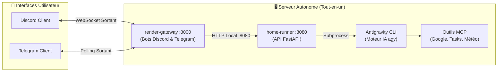
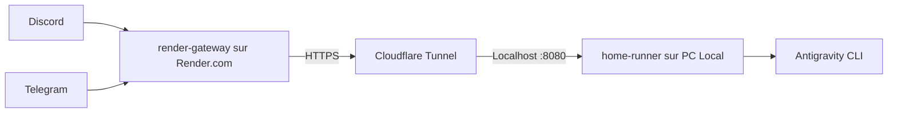

# 🤖 Assistant Personnel — AI Agent & Gateway

<p align="center">
  
  
  
  
  
  
</p>

> **Un assistant personnel IA autonome, ultra-rapide et connecté à votre quotidien.**  
> Pilotez votre machine, vos e-mails, votre agenda, vos tâches et le web directement depuis **Discord** et **Telegram**, propulsé par **Antigravity CLI** et les modèles de raisonnement Google Gemini.

---

## 🌟 Fonctionnalités Principales

- **🌅 Briefing Matinal Automatisé** :
  - Déclenché automatiquement chaque matin à **08h00** ou sur commande (`/briefing`).
  - Analyse synthétique : **Emploi du temps du jour**, **E-mails importants filtrés** (anti-spam), **Tâches Google Tasks**, **Météo locale** et **Actualités économiques clés**.
- **⚡ Réponses Ultra-Rapides & Mode Éco** :
  - Optimisé pour le chat mobile avec `gemini-3.8-flash-low` et effort de raisonnement direct pour des réponses complètes en moins de **15 à 20 secondes**.
- **💬 Intégration Bi-Plateforme Complète** :
  - **Discord** : Commandes slash natives (`/ask`, `/briefing`, `/model`, `/session`, `/clear`), accusé de réception instantané (évite les erreurs timeout 3s), réponses élégantes découpées en blocs formatés.
  - **Telegram** : Menus interactifs, boutons inline, mode webhook ou polling automatique sans configuration réseau.
- **🧠 Gestion de Contexte & Mémoire** :
  - Mémoire de conversation persistante avec suivi des tours de discussion.
  - Commutation de session ou de modèle à la volée sans redémarrer le serveur.
  - Possibilité de reprendre d'anciennes conversations passées ou de purger le chat.
- **🔌 Connecteurs MCP (Model Context Protocol)** :
  - 📅 **Google Agenda** : Lecture et création d'événements.
  - ✉️ **Gmail** : Tri et résumé intelligent des e-mails prioritaires.
  - 📋 **Google Tasks** : Gestion et suivi des listes de tâches.
  - 📁 **Google Drive** : Recherche et consultation de documents.
  - 🌤️ **Météo** & 🌐 **Recherche Web DuckDuckGo**.

---

## 🏗️ Architecture & Déploiement

Le projet supporte **deux modes de déploiement** selon vos besoins :

### Mode 1 : Serveur Autonome Tout-en-un (Recommandé) ⭐
Idéal sur un serveur personnel (mini-PC, Raspberry Pi, serveur Debian/Ubuntu) allumé 24/7.



> [!TIP]
> **Zéro galère réseau** : Dans ce mode, **aucun port n'a besoin d'être ouvert** sur votre box Internet, aucun nom de domaine n'est requis, et le bot reste actif en permanence.

---

### Mode 2 : Architecture Hybride Cloud + PC Local
Si vous préférez héberger la passerelle sur Render et le moteur IA sur votre PC de bureau personnel :



---

## 📂 Structure du Répertoire

```text
assistant-perso/
├── deploy.sh                  # 🚀 Script de déploiement automatique en 1 commande
├── GEMINI.md                  # 🎯 Directives système pour l'assistant IA
├── .env.example               # ⚙️ Modèle de configuration globale
├── systemd/                   # 🐧 Units systemd pour lancement en tâche de fond
│   ├── assistant-runner.service
│   └── assistant-gateway.service
├── home-runner/               # 🏠 Moteur local & Bridge Antigravity CLI
│   ├── agy_bridge.py          # Gestionnaire de sessions, parsing et subprocess
│   ├── main.py                # API FastAPI privée (/run, /session, /models)
│   ├── requirements.txt
│   └── setup.sh
├── render-gateway/            # 🌐 Passerelle bots Discord & Telegram
│   ├── bots/
│   │   ├── discord_bot.py     # Bot Discord (commandes slash, gestion des flux)
│   │   └── telegram_bot.py    # Bot Telegram (polling/webhook, briefing)
│   ├── gateway.py             # Client HTTP asynchrone vers le runner
│   ├── main.py                # Serveur FastAPI & planificateur matinal
│   ├── Dockerfile
│   └── render.yaml
└── integrations/              # 🔌 Connecteurs & Authentification
    └── google-workspace/      # Scripts OAuth et connecteur Google Tasks MCP
        ├── setup_oauth.py
        └── tasks_mcp.py
```

---

## ⚡ Guide de Démarrage Rapide

### 1. Prérequis
- Un système Linux (Fedora, Debian, Ubuntu, etc.)
- Python ≥ 3.11
- [Antigravity CLI](https://github.com/google/antigravity) installé et authentifié (`agy login`)

### 2. Installation en une commande
Clonez le dépôt et lancez le script d'installation automatisé :

```bash
git clone https://github.com/VOTRE_UTILISATEUR/assistant-perso.git
cd assistant-perso
chmod +x deploy.sh
./deploy.sh
```

Le script s'occupe de :
1. Vérifier la présence de Python 3 et d'Antigravity CLI.
2. Créer les environnements virtuels Python (`.venv`) pour `home-runner` et `render-gateway`.
3. Installer l'ensemble des dépendances.
4. Générer automatiquement une `SECRET_KEY` cryptographique sécurisée.
5. Préparer les fichiers `.env`.

### 3. Configuration des clés
Éditez `render-gateway/.env` pour renseigner vos tokens de messagerie :

```dotenv
# Bot Telegram (obtenu via @BotFather)
TELEGRAM_TOKEN=123456789:ABCDEF...

# Bot Discord (obtenu via le portail développeur Discord)
DISCORD_TOKEN=MTE...

# Sécurité (optionnel : restreindre à vos propres identifiants)
DISCORD_ALLOWED_USER_IDS=123456789012345678
TELEGRAM_ALLOWED_USER_IDS=123456789
```

### 4. Lancement en tâche de fond (Systemd)

Pour que votre assistant démarre automatiquement au boot du système et survive aux redémarrages :

```bash
# Copier les services dans systemd utilisateur
mkdir -p ~/.config/systemd/user/
cp systemd/*.service ~/.config/systemd/user/

# Recharger et activer les services
systemctl --user daemon-reload
systemctl --user enable --now assistant-runner assistant-gateway

# Vérifier que tout fonctionne
systemctl --user status assistant-runner assistant-gateway
```

Les journaux en temps réel sont consultables avec :
```bash
journalctl --user -u assistant-gateway -f
```

---

## 🎮 Commandes Disponibles

### Sur Discord

| Commande | Description |
|---|---|
| `/ask <question>` | Pose une question ou donne une tâche à l'assistant |
| `/briefing` | Déclenche immédiatement le briefing matinal complet |
| `/model` | Affiche ou change le modèle d'IA actif (`gemini-3.8-flash-low`, `claude-sonnet-4-6`, etc.) |
| `/session` | Affiche l'ID et l'état de la session active |
| `/clear` | Efface le salon et démarre une nouvelle session vierge |

### Sur Telegram

| Commande | Description |
|---|---|
| `/briefing` | Génère votre briefing matinal interactif |
| `/model` | Menu interactif de sélection des modèles avec boutons |
| `/session` | Affiche les détails de la session en cours |
| `/clear` | Démarre une conversation neuve |
| `/skills` | Liste des outils et intégrations actives |
| `/help` | Affiche l'aide et les commandes |

---

## 🔒 Sécurité & Confidentialité

- **Authentification forte** : Chaque échange entre la passerelle (`render-gateway`) et le moteur local (`home-runner`) est protégé par une clé `X-Secret-Key` de 256 bits.
- **Accès restreint (Whitelist)** : Vous pouvez définir `DISCORD_ALLOWED_USER_IDS` et `TELEGRAM_ALLOWED_USER_IDS` afin que personne d'autre ne puisse interagir avec votre assistant.
- **Protection des données** : Tous vos identifiants, tokens OAuth Google et conversations restent stockés localement sur votre machine et sont exclus du suivi Git via `.gitignore`.

---

## 📜 Licence

Ce projet est sous licence libre **MIT**. Consultez le fichier [LICENSE](LICENSE) pour plus de détails.
