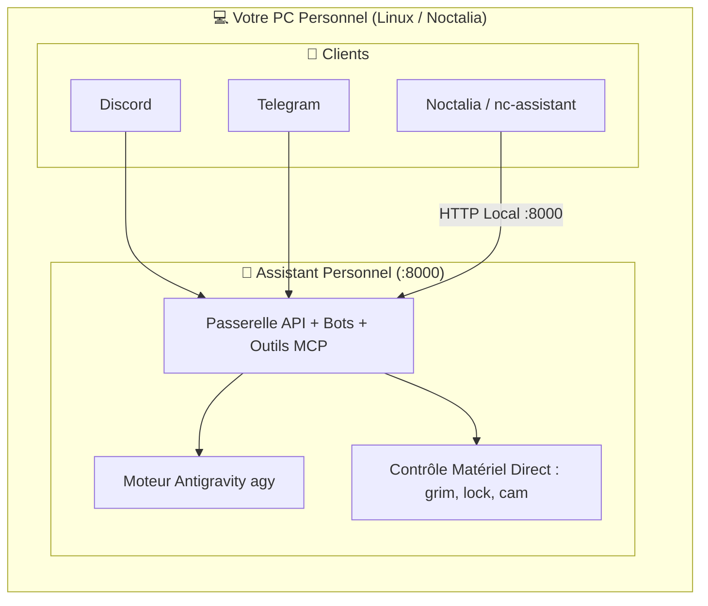

# 🤖 Assistant Personnel — JARVIS

<p align="center">
  
  
  
  
  
  
</p>

> **Assistant personnel IA autonome, ultra-rapide et connecté à votre quotidien.**  
> Pilotez votre machine, vos e-mails, votre agenda, vos tâches, vos études et votre budget directement depuis **Discord**, **Telegram** et le bureau **Noctalia** (Hyprland), propulsé par **Antigravity CLI** et les modèles de raisonnement Google Gemini.

---

## 🏗️ Deux Modes de Déploiement

Le même projet peut être déployé au choix selon vos préférences :

### Option 1 : Déploiement Local (sur votre PC) 💻
Tout s'exécute directement sur votre PC personnel (Fedora / Arch Linux avec Hyprland / Noctalia).  
- **Avantages** : Contrôle matériel direct (`grim` capture d'écran, webcam `/dev/video0`, verrouillage de session, presse-papier Wayland `wl-copy`).
- **Noctalia** : Se connecte directement en local sur `http://127.0.0.1:8000`.



---

### Option 2 : Déploiement sur un Serveur Distant Hébergé 🌐
L'assistant est installé sur un serveur permanent (VPS, Mini-PC, serveur Debian/Ubuntu) allumé 24/7.  
- **Avantages** : Disponible en permanence sur Discord, Telegram, Moodle, l'agenda et les rappels récurrents, même lorsque votre PC est éteint.
- **Noctalia** : Se connecte au serveur distant via réseau privé (Tailscale `http://100.x.y.z:8000`) ou tunnel sécurisé (Cloudflare `https://assistant.mondomaine.fr`).

```mermaid
flowchart LR
    subgraph Clients["📱 Vos Appareils"]
        D[Discord]
        T[Telegram]
        N[PC Noctalia / nc-assistant]
    end

    subgraph Serveur["🖥️ Serveur Distant Hébergé (24/7)"]
        APP[Assistant Personnel :8000\n(Bots, API, Outils MCP)]
        AGY[Moteur Antigravity agy]
        APP --> AGY
    end

    D <-->|Internet| APP
    T <-->|Internet| APP
    N <-->|Tailscale ou HTTPS| APP
```

---

## 🌟 Fonctionnalités & Modules (Style MCP)

Chaque outil est un module autonome activable ou désactivable à l'installation :

- 🎓 **Moodle EPITA** (`/devoirs`) : Récupération automatique des devoirs, TPs et dates d'échéances.
- 💰 **Finances & Budget** (`/depense`, `/budget`) : Enregistrement de dépenses, analyse OCR de tickets de caisse par Gemini, gestion du budget mensuel et webhook Apple Pay.
- 🛒 **Liste de Courses Interactive** (`/courses`) : Liste interactive avec boutons Telegram/Discord pour cocher et décocher en 1 clic.
- 🧠 **Second Cerveau Obsidian** (`/kb`, `/note`) : Recherche instantanée dans votre vault Markdown et capture rapide de notes classées.
- 🎯 **Mode Focus & Deep Work** (`/focus`, `/stats`) : Minuteur Pomodoro, statistiques d'heures de travail et synchronisation DND.
- 💡 **Incubateur d'Idées** (`/idea`, `/ideas`) : Brainstorming guidé, génération de stack, plan MVP en 3 étapes et scoring.
- 📁 **Cockpit Projets & Dev Agent** (`/proj`, `/dev`) : Supervision Git et agent développeur autonome dans le répertoire de travail.
- 🌐 **Boîte de Réception & Radar Tech** (`/radar`) : Capture de liens web enrichis et veille sur les dépôts GitHub tendances et HackerNews.
- 🗺️ **Conseiller Trajets & Départs** (`/depart`) : Calcul d'heure de départ avec marge pour vos cours et rendez-vous.
- 💻 **Contrôle PC & Système** (`/pc`, `/screenshot`, `/cam`, `/lock`, `/git`, `/say`, `/copy`, `/paste`) : Pilotage du bureau Linux.
- 🔒 **Code PIN de Sécurité** : Clavier virtuel interactif (pavé 4x3) protégeant les opérations sensibles.
- ⚡ **Routeur NLP 0-token** : Détection et exécution locale instantanée (<5ms) pour toutes les requêtes du quotidien sans surcoût IA.
- 🌅 **Briefing Matinal Automatisé** (`/briefing`) : Météo, tâches Google Tasks, emails importants et planning du jour à 08h00.
- ⏰ **Rappels Persistants & Récurrents** (`/rappel`, `/rappels`) : Détection en langage naturel, snooze et stockage SQLite.
- 🎙️ **Messages Vocaux (STT)** : Transcription audio automatique (Groq Whisper, OpenAI Whisper ou local `faster-whisper`).
- 📐 **Rendu LaTeX** : Conversion automatique des formules `$$...$$` en images PNG nettes adaptées au mode sombre.

---

## 🚀 Installation Rapide

```bash
# 1. Cloner le projet
git clone https://github.com/RaphaelBlanc/JARVIS-BIS.git
cd JARVIS-BIS

# 2. Lancer l'installateur interactif
./deploy.sh setup

# 3. Démarrer l'assistant
./deploy.sh start
```

L'installateur interactif (`./deploy.sh setup`) vous demandera pour chaque service s'il doit être activé et vous invitera à saisir les tokens correspondants (Telegram, Discord, Moodle, etc.).

---

## 🖥️ Intégration Noctalia (Distro Linux)

L'assistant expose une API REST standard (`8000`) documentée dans :  
👉 **[docs/NOCTALIA_API.md](docs/NOCTALIA_API.md)**

Le mainteneur de Noctalia peut intégrer `nc-assistant` en appelant simplement :
- `POST /api/ask` (requête synchrone)
- `GET /api/stream` (flux Server-Sent Events pour affichage temps réel dans l'île Quickshell)
- `POST /api/action` (exécution directe d'une action d'un module)
- `GET /api/status` (état de santé)
- `POST /api/briefing` (briefing matinal)

---

## 📂 Structure du Répertoire

```text
JARVIS-BIS/
├── deploy.sh                  # 🚀 Script de déploiement et de lancement
├── setup_wizard.py            # 🧙 Assistant interactif d'installation des modules
├── core/                      # 🧠 Cœur applicatif unifié
│   ├── config.py              # Configuration globale et chemins
│   ├── hardware_relay.py      # Exécution directe des outils matériels
│   └── tools/                 # Modules métiers (Moodle, Budget, Courses, Obsidian...)
├── home-runner/               # 🏠 Moteur d'exécution Antigravity CLI (agy)
├── gateway/                   # 🌐 Passerelle API FastAPI, bots Discord et Telegram
├── docs/
│   └── NOCTALIA_API.md        # 📘 Spécification d'API pour la distro Noctalia
├── systemd/                   # 🐧 Services systemd pour démarrage automatique
├── tests/                     # 🧪 Suite de tests unitaires
└── requirements.txt           # 📦 Dépendances Python
```
