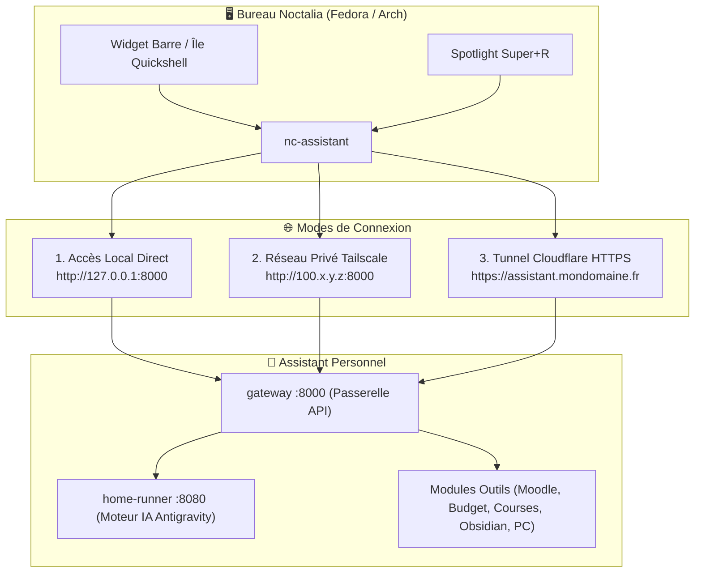

# 📘 Spécification de l'API Assistant Personnel pour Noctalia

> **Document de référence pour le mainteneur de Noctalia (`noctalia-config`)**  
> Ce document décrit les points de terminaison HTTP (REST) et Streaming (SSE) exposés par la passerelle de l'assistant (`gateway` sur le port `8000`).  
> Il permet d'intégrer le bureau Noctalia (barre, île dynamique Quickshell, Spotlight `Super+R`, CLI `nc-assistant`) aussi bien en **accès local direct** qu'en **accès distant hébergé** (Tailscale ou Cloudflare Tunnel).

---

## 1. Principes et Topologie Réseau

L'assistant expose son API sur le **port 8000** (le Gateway). Il ne faut jamais interroger directement le runner interne (`8080`).



- **En local** : l'URL configurée dans `~/.config/nc/assistant.conf` est `http://127.0.0.1:8000`.
- **En distant via Tailscale** : l'adresse IP du serveur Tailscale (ex: `http://100.64.0.15:8000`).
- **En distant via Cloudflare Tunnel** : une URL HTTPS publique sécurisée (ex: `https://assistant.domaine.fr`).

---

## 2. Authentification

Toutes les requêtes de l'API (à l'exception de `/ping` et `/health`) doivent être authentifiées avec la clé partagée `SECRET_KEY` configurée sur le serveur.

L'authentification s'effectue via l'en-tête HTTP :
```http
X-Secret-Key: <VOTRE_SECRET_KEY>
```
*Alternative supportée :* `Authorization: Bearer <VOTRE_SECRET_KEY>`

---

## 3. Endpoints Principaux

### 3.1 Poser une question (`POST /api/ask`)

Interroge le moteur de raisonnement de l'assistant (avec mémoire de session et continuité de dialogue).

- **Méthode** : `POST /api/ask`
- **Headers** :
  - `Content-Type: application/json`
  - `X-Secret-Key: <SECRET_KEY>`
- **Corps de la requête (JSON)** :
  ```json
  {
    "prompt": "Quel est mon programme et mes devoirs aujourd'hui ?",
    "platform": "noctalia",
    "user_id": "noctalia",
    "timeout": 120,
    "continue_session": true,
    "reset_session": false,
    "model": null,
    "effort": null
  }
  ```
- **Réponse réussie (200 OK)** :
  ```json
  {
    "success": true,
    "output": "Voici votre planning pour aujourd'hui :\n• 09h00 : Cours Réseau\n• 14h00 : TP C++",
    "error": null
  }
  ```
- **Codes d'erreur** :
  - `401 Unauthorized` : Clé secrète invalide ou absente.
  - `429 Too Many Requests` : Débit excessif (en-tête `Retry-After` fourni).
  - `500 Internal Server Error` : Erreur interne du runner.

---

### 3.2 Réponses en Streaming temps réel (`GET /api/stream`)

Permet d'afficher la réponse mot par mot au fur et à mesure de sa génération (Server-Sent Events) dans une bulle de dialogue Quickshell ou un widget fluide.

- **Méthode** : `GET /api/stream?prompt=<TEXTE_URL_ENCODE>`
- **Headers** :
  - `X-Secret-Key: <SECRET_KEY>` (ou paramètre `?secret_key=<CLE>`)
- **Format du flux (text/event-stream)** :
  ```text
  data: {"chunk": "Bonjour "}

  data: {"chunk": "voici votre "}

  data: {"chunk": "résumé du jour : "}

  data: {"done": true, "output": "Bonjour voici votre résumé du jour : ..."}
  ```

---

### 3.3 Exécuter une action de module (`POST /api/action`)

Exécute instantanément (sans appel LLM ou en mode fast-path 0-token) une action métier des modules activés.

- **Méthode** : `POST /api/action`
- **Headers** :
  - `Content-Type: application/json`
  - `X-Secret-Key: <SECRET_KEY>`
- **Corps de la requête (JSON)** :
  ```json
  {
    "tool": "shopping",
    "action": "list",
    "params": {},
    "platform": "noctalia"
  }
  ```

#### Exemples d'actions courantes :

| Module (`tool`) | Action (`action`) | Paramètres (`params`) | Description |
|---|---|---|---|
| `shopping` | `list` | `{}` | Affiche la liste des courses |
| `shopping` | `add` | `{"text": "lait, café"}` | Ajoute des articles |
| `shopping` | `clear_done` | `{}` | Retire les articles cochés |
| `moodle` | `devoirs` | `{}` | Récupère les devoirs et échéances EPITA |
| `expenses` | `summary` | `{}` | Bilan financier du mois en cours |
| `expenses` | `add` | `{"amount": 12.50, "description": "Repas"}` | Enregistre une dépense |
| `obsidian` | `search` | `{"query": "linux kernel"}` | Recherche dans le coffre Obsidian |
| `obsidian` | `note` | `{"text": "Idée d'architecture..."}` | Ajoute une note classée |
| `focus` | `start` | `{"duration": 45, "topic": "Dev"}` | Lance un Pomodoro Deep Work |
| `focus` | `stats` | `{}` | Statistiques de travail profond |
| `system_pc` | `screenshot` | `{}` | Capture d'écran (via grim) |
| `system_pc` | `lock` | `{}` | Verrouille la session Hyprland |
| `system_pc` | `hardware_health` | `{}` | Diagnostic CPU, RAM, batterie |
| `inbox` | `radar` | `{"topic": "cyber"}` | Veille technologique et GitHub |
| `travel` | `plan` | `{"destination": "Paris", "time": "08:30"}` | Calcul d'heure de départ |

---

### 3.4 Diagnostic d'état complet (`GET /api/status`)

Permet à `nc-assistant verifier` ou à l'icône de la barre Noctalia d'afficher l'état en direct du système.

- **Méthode** : `GET /api/status`
- **Headers** : `X-Secret-Key: <SECRET_KEY>`
- **Réponse (200 OK)** :
  ```json
  {
    "online": true,
    "version": "1.0.0",
    "deploy_mode": "server",
    "pc_agent_connected": true,
    "runner": {
      "status": "ok",
      "agy_available": true
    },
    "session": {
      "model": "gemini-3.8-flash-low",
      "turns": 4
    },
    "tools": [
      {"id": "shopping", "name": "Liste de Courses", "enabled": true, "requires_local_hardware": false},
      {"id": "moodle", "name": "Moodle EPITA", "enabled": true, "requires_local_hardware": false},
      {"id": "system_pc", "name": "Contrôle PC", "enabled": true, "requires_local_hardware": true}
    ],
    "gateway": {
      "public_url": "https://assistant.mondomaine.fr"
    }
  }
  ```

> [!TIP]
> Le champ `pc_agent_connected` indique si le PC portable de l'utilisateur est actuellement connecté en WebSocket au serveur distant. Si `false`, les commandes matérielles locales (`system_pc`) sont indisponibles.

---

### 3.5 Briefing matinal (`POST /api/briefing`)

- **Méthode** : `POST /api/briefing`
- **Corps de la requête (JSON)** :
  ```json
  {
    "force_refresh": false
  }
  ```
- **Réponse (200 OK)** :
  ```json
  {
    "success": true,
    "output": "🌅 Briefing du matin...\n",
    "cached": true,
    "error": null
  }
  ```

---

## 4. Exemple d'Implémentation Client Python (`nc-assistant`)

Voici le script type pour le client Noctalia `home/.local/bin/nc-assistant` en standard library Python pure (aucune dépendance requise) :

```python
#!/usr/bin/env python3
import sys
import json
import urllib.request
import urllib.error
from pathlib import Path

CONFIG_FILE = Path.home() / ".config" / "nc" / "assistant.conf"

def load_config():
    if not CONFIG_FILE.exists():
        sys.stderr.write("Configuration introuvable (~/.config/nc/assistant.conf).\n")
        sys.exit(1)
    cfg = {}
    with open(CONFIG_FILE, "r") as f:
        for line in f:
            if "=" in line and not line.startswith("#"):
                k, v = line.strip().split("=", 1)
                cfg[k.strip()] = v.strip().strip("'\"")
    return cfg

def call_api(endpoint, payload=None):
    cfg = load_config()
    url = f"{cfg.get('URL', 'http://127.0.0.1:8000').rstrip('/')}{endpoint}"
    secret = cfg.get("SECRET_KEY", "")
    headers = {
        "X-Secret-Key": secret,
        "Content-Type": "application/json",
    }
    data = json.dumps(payload).encode("utf-8") if payload else None
    req = urllib.request.Request(url, data=data, headers=headers)
    try:
        with urllib.request.urlopen(req, timeout=60) as resp:
            return json.loads(resp.read().decode("utf-8"))
    except urllib.error.HTTPError as e:
        sys.stderr.write(f"Erreur HTTP {e.code} : {e.reason}\n")
        sys.exit(1)
    except Exception as e:
        sys.stderr.write(f"Erreur réseau : {e}\n")
        sys.exit(1)

if __name__ == "__main__":
    if len(sys.argv) < 2:
        print("Usage: nc-assistant [demander <prompt> | briefing | etat | action <tool> <action>]")
        sys.exit(0)

    cmd = sys.argv[1]
    if cmd == "demander":
        prompt = " ".join(sys.argv[2:])
        res = call_api("/api/ask", {"prompt": prompt, "platform": "noctalia"})
        print(res.get("output", ""))
    elif cmd == "briefing":
        res = call_api("/api/briefing", {"force_refresh": False})
        print(res.get("output", ""))
    elif cmd == "etat":
        res = call_api("/api/status")
        print(json.dumps(res, indent=2))
    elif cmd == "action":
        tool, act = sys.argv[2], sys.argv[3]
        res = call_api("/api/action", {"tool": tool, "action": act})
        print(res.get("message", ""))
```
